# Unified investigation pipeline

One investigation over every source MOKS reads: Kubernetes, metrics, logs, traces, deployments, Git, ML anomaly
observations, approved past incidents and runbooks. Code collects the evidence through the ToolExecutor and turns
each stored result into one shared record, the evidence contract. CrewAI agents reason over those records: an
analyst proposes hypotheses and asks for more evidence, and a reviewer challenges them. Code decides what stands.
It checks every citation against the ledger and scores each hypothesis by named factors. The reviewer's verdict can
lower a score, never raise it.

Status: on this branch, tested locally with fixture connectors, a scripted model and crewai 1.15.41 (see
[What is still unverified](#what-is-still-unverified)). It runs as the CrewAI console flow `unified_investigation`
on the CrewAI worker, beside the workload crew, and changes nothing about the investigations that exist today.

Code: `backend/moks/intelligence/`. UI: `frontend/src/intelligence/`. Tests: `backend/tests/test_unified_*.py`,
`frontend/src/intelligence/UnifiedPanel.test.tsx`.

## 1. Pipeline

```mermaid
flowchart LR
  subgraph Collect[collected by code, through the ToolExecutor]
    D[1 detect] --> C[2 classify] --> I[3 identify] --> T[4 telemetry] --> TR[5 traces] --> CH[6 changes] --> A[7 anomalies] --> H[8 history] --> S[9 semantic]
  end
  subgraph Reason[reasoned]
    HY[10 hypotheses<br/>library + analyst agent] --> M[11 more evidence<br/>allowlisted probes] --> V[12 validate<br/>code + reviewer agent]
  end
  subgraph Decide[decided by code]
    R[13 rca<br/>scores] --> RM[14 remediation] --> RP[15 report]
  end
  S --> HY
  V --> R
```



| # | Stage | What it does | Reads |
|---|---|---|---|
| 1 | Incident detection | Firing alerts in scope and the namespace's health findings; the trigger (person, schedule, alert) and the reported symptom. | `prom_alerts`, `k8s_triage` |
| 2 | Incident classification | Categories (latency, errors, availability, saturation, deployment, data store, network, capacity) and an estimated severity, by stated rules. | nothing |
| 3 | Resource and service identification | The workload (requested, or the worst one in the triage findings, or the one the question names), its pods by owner reference, its Service. | `k8s_rollout_history` or `k8s_workloads`, `k8s_list_pods`, `k8s_services` |
| 4 | Metrics and logs | Golden signals, pod CPU/memory/throttling, error logs, the crashed container's last words, warning events. Dependencies from the hosts its logs could not reach. | `prom_golden_signals`, `prom_pod_resources`, `loki_search`, `k8s_pod_logs`, `k8s_events` |
| 5 | Distributed traces | A trace backend when a `trace_search*` tool is registered; otherwise the trace ids on the error lines, followed across the namespace's services through Loki. | `trace_search*` or `loki_search(trace_id)` |
| 6 | Deployment and Git changes | Rollouts in the window, configuration and missing references, commits, the running commit. | `k8s_rollout_history`, `k8s_config_audit`, `git_recent_commits`, `git_compare_deployment` |
| 7 | ML anomaly correlation | The anomaly model's observations for the target, set against the onset. | `ml_observations` |
| 8 | Historical incidents (RAG) | Approved past incidents with similar symptoms, and postmortems about them. | `similar_incidents`, `kb_search` |
| 9 | Semantic search | Runbooks about these symptoms, by meaning (hybrid BM25 + vectors when an embedding index answers). | `kb_search` |
| 10 | Hypotheses | Failure patterns the evidence matches, then what the analyst agent proposes. | nothing new |
| 11 | More evidence | Probes for what the leading hypotheses lack: the library's own, and the analyst's requests from the allowlist. | `collect.PROBES` |
| 12 | Validation | The code's independent review of every hypothesis, then the reviewer agent's challenges. | nothing new |
| 13 | Root-cause analysis | Hypotheses ranked by score; those not shown are listed with why. | nothing |
| 14 | Remediation | Allowlisted actions to consider for the strongest hypotheses. Each needs an approved action plan. | nothing |
| 15 | Report | The sections in [section 5](#5-reports). | nothing |

A stage that fails, times out or runs out of budget ends `failed`, `partial` or `skipped` with its reason, and the pipeline
goes on. Cancellation is the one exception (see [section 7](#7-reliability-and-security)).

### Integration point

`Investigator._investigate` has one more branch: when the queued request's `crewai` block names the flow
`unified_investigation`, it calls `intelligence.engine.run()` instead of the workload crew or the graph. Everything
before it is unchanged: authorization at run time, connectors, the AccessGuard, the lease and the cancel watcher.
Everything after it is unchanged too: `validate_claims`, `verify_causes`, relevance, the stored report and the reply
in the conversation. The report gains one field, `unified`.

The flow is registered in the CrewAI console (`crew/config.py` `FLOWS`), so it is numbered, logged, scheduled and switched
on or off there like the workload flow, and it is claimed only by the CrewAI worker. Its workload input is optional.

## 2. Evidence contract

`moks.evidence/v1`, in `intelligence/evidence.py`. One `EvidenceItem` per stored Evidence row. It is built only from
that row and the investigation's own scope, never from model text. Every read in MOKS passes the ToolExecutor, which
stores the row, so the contract applies to every engine and every agent.
`GET /investigations/{id}/evidence-items` serves it for any investigation, including LangGraph and workload-crew runs.
The JSON Schema is at `GET /intelligence/evidence-schema`.

| Field | Meaning |
|---|---|
| `id`, `investigation_id` | `E7`, and the investigation it belongs to. |
| `source_type` | `kubernetes`, `metrics`, `logs`, `traces`, `deployment`, `git`, `configuration`, `alert`, `ml_anomaly`, `knowledge`, `historical_incident`, `dependency`, `cost`, `datastore`, `policy`. |
| `source_ref` | The tool, connector type and id, the exact query or API path the tool reported, and the arguments. |
| `resource` | `k8s://<env>/<ns>[/<Kind>/<name>]`, `git://<repo>[/<path>]`, `knowledge://<env>[/<ns>]`, `ml://<env>/<ns>[/<service>]`, with kind, name and namespace. |
| `service`, `environment`, `namespace` | Where it applies. |
| `timestamp`, `time_range` | When it was collected, and the part of the window it read. |
| `observation` | The tool's own summary of the stored, redacted result. |
| `raw_ref` | `moks://investigations/<id>/evidence/<ref>`, and the authorized route that returns the stored row. |
| `confidence` | How far this record can be relied on to describe what it read: the source's stated reliability, times 0.7 when incomplete, times 0.75 when stale, with the basis listed. A failed or refused read is `none`. This is about the evidence, not about any hypothesis. |
| `access` | Principal, permission, environment, scope (`namespace:<ns>`, `cluster`, `knowledge:<env>/<ns>`), allow or deny with the reason, redacted, truncated, untrusted content, realm. |
| `status`, `kind` | `ok`, `partial`, `failed` or `denied`, and the existing ledger kind (observation, incomplete, tool_error, access_denied, documentation, historical). |
| `signals`, `stage`, `collected_by` | What the pipeline read from it, which stage asked, and which component or agent asked. |

Stated reliabilities (`RELIABILITY`), shown with every item:

| Source | Weight | Why |
|---|---|---|
| kubernetes, deployment | 0.95 | the API server's or Argo CD's own record |
| configuration | 0.9 | pod specs as the API server returns them |
| metrics, dependency, datastore | 0.85 | sampled series; aggregation can hide short events |
| git | 0.8 | a commit is not necessarily deployed |
| logs, traces | 0.75 | what the application chose to write |
| alert | 0.7 | thresholds someone chose |
| ml_anomaly | 0.55, shadow 0.35 | "unusual for this workload", never why |
| knowledge, historical_incident | 0.3 | what someone wrote down, or a lead |

The workload crew's agents see this contract too, through the same Evidence rows. The crew's own registry and
prompts are unchanged in this branch, so that work on the crew can adopt `EvidenceItem.brief()` without conflicts.

## 3. Signals and hypotheses

`intelligence/signals.py` reads each stored result into named signals with the time the evidence gives them:
`metric.latency_increase` and its change point, `log.db_pool_exhausted` and its first line, `deploy.rollout` and the
revision's creation, `ml.anomaly:latency_p95`, `history.cause:connection_pool`, and so on. A signal can be **present**,
or **checked and absent**: memory far below its limit, no rollout in the window. Absence is an observation, and it is
what contradicts a hypothesis. A source that was not read gives no signal at all, and scoring counts that as missing
evidence, not as absence. Thresholds are constants in that file (`INCREASE = 1.5`, `THROTTLING = 0.25` and so on).

`intelligence/hypotheses.py` is a library of thirteen failure patterns. Each names:

- its **required evidence groups** (one signal from each group satisfies it);
- what supports it and what contradicts it;
- which signals stand for the cause or change, and which for the symptom;
- its topic (for runbooks and past incidents), and the patterns it is usually a symptom of;
- the probes that collect what is missing, how a person verifies it, and the remediation to consider.

The patterns are connection pool exhaustion, deployment regression, OOM against the memory limit, start-up failure,
missing configuration reference, image pull failure, CPU saturation, dependency failure, DNS failure, node pressure,
scheduling capacity, probe failure and traffic surge. A pattern becomes a hypothesis when the evidence satisfies at least
one required group. A new failure mode is a new entry, not new code.

## 4. Scoring

```
score = 100 × clamp( 0.35 evidence_strength + 0.15 source_reliability + 0.20 temporal_correlation
                   + 0.15 dependency_relevance + 0.15 historical_similarity
                   − contradictions (≤ 0.35) − missing_evidence (≤ 0.25) − explained_by_stronger (0.15), 0, 1 )
```

| Factor | Rule |
|---|---|
| Evidence strength | 0.7 × the quality-weighted share of required groups observed (each group's best item confidence) + 0.3 × corroboration (independent live source types beyond the first, up to 3). |
| Source reliability | Mean stated reliability of the cited live sources. Documents and past incidents count only under historical similarity. |
| Temporal correlation | The cause or change nearest before the onset: 1.0 within 5 minutes, else exp(−lag/45 min), at least 0.15; 0.1 when the cause came after the effect; 0.5 when the evidence gives no times. |
| Dependency relevance | Per cited item: 1.0 about the target, 0.8 about a dependency it calls, 0.6 the same namespace, 0.2 elsewhere, 0.5 for Git and documents. |
| Historical similarity | The similarity score of an approved past incident resolved as this pattern's topic; 0.3 when only a runbook or postmortem describes it. |
| Contradictions | 0.25 × the reliability of each contradicting item (a required group checked and absent, or a signal the pattern names against it); 0.1 for each item the reviewer agent cites against it. |
| Missing evidence | 0.12 per required group whose sources were never read, 0.06 when they were read and showed nothing either way. |
| Explained by a stronger hypothesis | 0.15 when everything it rests on is evidence for a moderate or strong hypothesis that ranks above it, or one its pattern lists in `symptom_of`. A hypothesis that the other names as its cause (a traffic surge behind CPU saturation) is upstream and never explained away. |

Caps: an agent's hypothesis outside the library at most 60 ("moderate"); a review verdict of `contradicted` at most
40, `unsupported` at most 15. Bands: strong ≥ 70, moderate ≥ 45, weak ≥ 25, else insufficient. The existing Report's
low/medium/high is the band (strong → high, moderate → medium).

**The score ranks hypotheses within one investigation. It is not a probability, and it is not calibrated against
outcomes.** No model writes any part of it, and a model's own stated confidence is never read. Every factor is shown
with its value, its explanation and the evidence ids it used.

## 5. Reports

The `unified` block holds the following sections. Every sentence in them is built from the ledger by code.

- `executive_summary`
- `timeline`, with the onset marked
- `affected_services`
- `impact`: technical, and business only as far as evidence shows it (an Ingress, a production environment, a critical
  alert). Otherwise it says MOKS does not know.
- `observations`
- `hypotheses`, ranked, each with its score breakdown, review, required groups, supporting and contradicting evidence,
  verification steps and `explained_by`
- `supporting_evidence` and `contradictory_evidence`
- `historical_references`, `runbooks` and `anomaly_correlations`
- `verification_steps`
- `remediation`: `requires_approval: true`, `executable: false`, with the allowlisted `action_kind`
- `limitations`: gaps, scoring and ML notes, stages not completed, hypotheses not shown, refused requests
- `evidence_items` (the contract) and `signals`

The same content fills the existing Report fields (`summary`, `observed_facts`, `suspected_causes`, `missing_evidence`,
`next_steps`, `proposed_remediation`). Every existing screen, API and check reads it unchanged, and the engine's
`validate_claims`, `verify_causes` and relevance checks run on it as on any report. Model-written text appears only in a
hypothesis an agent proposed. It is marked, and the report is then `generated_by: llm`.

## 6. Agents

`intelligence/agents.py`. Two CrewAI agents, each one agent with no tools and one task. They run on MOKS's configured
model through `MoksCrewLLM` and `llm.budget` (credentials, reservations, daily limits, metering), on the workload crew's
thread Bridge, and within the CrewAI worker's crew slots.

- **Hypothesis analyst** (stage 10) sees:
  - the question;
  - the classification;
  - the ledger in the contract, each item with a 600-character excerpt cut from the stored, redacted result;
  - the signals;
  - the library's candidates with their scores;
  - the probe allowlist.

  It returns JSON with hypotheses (a library pattern or "other", cited ids) and probe requests. Invented citations are
  dropped and listed. A proposal left with no valid citation is not a hypothesis. A library pattern merges into that
  pattern's hypothesis (`rules+agent`). Unknown probes are refused and listed. Probe arguments are always bound by code
  to the target.
- **Evidence reviewer** (stage 12) sees the ledger and each hypothesis's claim and citations, never the analyst's
  reasoning or notes. It returns a verdict per hypothesis, evidence against it and unsupported assumptions. The verdict
  can only lower the code's. Citations must exist and have been read.

Without crewai at the pinned version, or without an active chat model, neither agent runs. The reasoning is then
rule-based, the report says so (`agents.mode: rules`), and the investigation's mode is `unified_rules`. A failed agent
costs its contribution, not the report.

## 7. Reliability and security

- **RBAC and source-level authorization.** Every read goes through `Investigator._call` and the ToolExecutor, which
  recheck the person's permissions and the environment's scope at execution time and audit each call. The two new tools
  follow the same rules:
  - `ml_observations` needs `ml.read` in the namespace;
  - `prom_golden_signals` runs templated, namespace-pinned queries, never raw PromQL.

  A cluster-scoped probe (nodes, DNS) is not attempted for a namespace-scoped person; the report records a gap instead.
- **No cross-tenant leakage.**
  - Every argument naming a place (environment, namespace, pods, repository, window) is bound by code from the
    investigation and the identified target.
  - Knowledge and similar-incident retrieval are scoped to the target's namespace and the person's access.
  - The code review drops any citation outside the investigation's environment and namespace, whoever cited it.
  - The benchmark runs in the evaluation realm, under its own environment, and removes what it seeded.
- **Cancellation and partial results.**
  - The cancel watcher cancels the run. The stage in progress ends `cancelled`, and the pipeline's state and evidence so
    far are stored with the partial report (`Investigator.partial_payload`).
  - A failed or refused read is a gap with its reason.
  - A stage that fails or times out ends `failed` or `partial`, and the report is still written.
- **Execution budgets.**
  - Tool calls: `MOKS_UNIFIED_MAX_TOOL_CALLS` (24), never above `MOKS_MAX_TOOL_CALLS`, with per-stage shares that scale
    down with the ceiling.
  - Wall time: `MOKS_UNIFIED_TIMEOUT_SECONDS` (150), within the investigation's remaining time, with per-stage limits
    and a reserve for the report.
  - Probes: `MOKS_UNIFIED_MAX_PROBES` (4).
  - Agents: `MOKS_UNIFIED_AGENT_TIMEOUT_SECONDS` (60) and at most three model calls each, within the investigation's
    token budget.
- **Distributed tracing.** The span `unified investigation` sits under the investigation's span. It has one
  `unified stage <key>` span per stage and `unified agent llm` per model call, and the executor's `tool …` spans nest
  inside them. Attributes are names, counts and outcomes only, never evidence or question text.
- **Prompt injection.** Evidence reaches the agents only inside random-tagged untrusted-data blocks, and their rules say
  it is data. Enforcement does not rely on that: agents have no tools, may only name allowlisted probes, cannot change the
  target, and everything they return is validated in code. A test feeds a log line that orders the scaling of the
  deployment to zero; nothing changes.
- **No destructive actions.** Every tool the pipeline can call is `read_only` and not `privileged` (tested). Remediation
  is a proposal: an allowlisted action kind for the existing approval workflow, never executed.
- **Audit.** Every read is a `tool.call` audit record. The run adds one `investigation.unified` record with the stage
  outcomes, tool calls, top patterns, agent mode and gap count. Progress is in `investigation_events` (`phase` and
  `pipeline`), and the CrewAI console's run log has a step per stage.

## 8. User interface

`frontend/src/intelligence/UnifiedPanel.tsx`, inside every report that has a `unified` block (the investigation page and
the chat thread):

- the fifteen stages, each one selectable for its reason, notes and evidence;
- the RCA summary with the classification;
- ranked hypotheses with a score bar, the band, the review verdict and the factor table;
- what each hypothesis needs (observed, checked and absent, or not shown);
- the timeline with the onset;
- affected services and impact;
- anomaly correlations (shadow-mode models marked);
- related incidents and runbooks;
- verification steps and remediation;
- the evidence ledger in the contract, filterable by source, each row showing its access, exact query and confidence basis;
- confidence and limitations.

Every evidence id opens the existing evidence drawer on the stored row. While the run is going, `LivePipeline`
follows the `pipeline` events. New investigation → CrewAI offers *Unified investigation* beside *Workload crew*, with the
workload optional. The CrewAI console lists the flow with its parameters, runs, logs and schedules.

## 9. API

| Route | |
|---|---|
| `POST /investigations/unified` | `{environment?, namespace, workload?, kind?, question?, minutes?}`. 404 while `MOKS_CREWAI_ENABLED` is false, 503 with no CrewAI worker or model, 409 when the flow is switched off. Same rate limit, queue limit, RBAC, scope and audit as every investigation. |
| `GET /investigations/{id}/evidence-items` | The contract for every evidence row of any investigation the caller may read (404 otherwise). |
| `GET /investigations/{id}/evidence/{ref}` | One item's contract and the stored, redacted row it describes. |
| `GET /intelligence/evidence-schema` | The contract's JSON Schema. |
| `GET /investigate/config` | Additive `unified: {flow, available, reason, stages}`. |
| `POST /crewai/flows/unified_investigation/run` | The console's generic run route works for this flow. |

Backward compatibility: existing routes, payloads and engines are unchanged; every new report field is additive. Scheduled
and console runs accept a flow without a workload.

## 10. Benchmark

`moks benchmark [--engines langgraph,crewai,crewai_improved,unified] [--llm] [--improved-flow NAME] [--case ID] [--json F] [--markdown F]`,
or `moks eval investigation_benchmark` (dataset kind `benchmark`, with gates on the unified pipeline in the Evals page).

It replays eight recorded incidents (`evals/datasets/investigation_benchmark.yaml`) through each engine's real
Investigator against fixture Kubernetes, Prometheus, Loki and Git connectors. Runbooks, approved past incidents and
anomaly observations are seeded in the evaluation realm. The cases:

- the brief's payment example (pool exhaustion after a deployment);
- OOM after a limit change;
- DNS failure;
- a bad image tag;
- a traffic surge;
- a Redis outage with a red-herring deployment;
- a missing Secret;
- a control case with nothing wrong.

Some cases leave the workload out, so target identification is part of the test.

Measures:

- **accuracy@1 and @3**: the expected pattern key, or the expected words for engines without keys;
- **acceptable@1**: the expected cause or an accepted alternative;
- **evidence coverage**: the share of needed source types read;
- **citation correctness**: citations that name stored, successful reads and, for the unified pipeline, reads that carry
  a signal relevant to the cause;
- **false conclusions**: forbidden causes at medium or high confidence, or any confident cause in the control case;
- **time, tool calls, tokens and cost**.

An engine that cannot run is reported as not run, with the reason, never scored as zero.

Measured on 2026-11-20, rules mode (no model), local Postgres:

| engine | cases | accuracy@1 | accuracy@3 | acceptable@1 | coverage | citations correct | false conclusions | median s | tool calls |
|---|---|---|---|---|---|---|---|---|---|
| langgraph | 8 | 0.571 | 0.571 | 0.571 | 0.704 | 1.0 | 0 | 0.15 | 15.9 |
| unified | 8 | 0.857 | 1.0 | 1.0 | 1.0 | 1.0 | 0 | 0.14 | 15.8 |
| crewai, crewai_improved | not run: a crew needs a model (`--llm`); no improved flow was named | | | | | | | | |

The one unified miss at rank 1 is the traffic surge, where CPU saturation (the mechanism) ranks just above the surge
(its cause). It is left as measured; the weights were not tuned to this dataset. **These are synthetic scenarios with
known answers, written alongside the engine. They show behaviour, not accuracy on real incidents.**

## 11. How the other work plugs in

- **A richer crew (specialist agents).** Register its flow name and run `moks benchmark --llm --improved-flow <name>`. Its
  tool calls already produce the contract through the Evidence rows. Its agents can show `EvidenceItem.brief()` lines.
- **A trace backend.** Any registered tool named `trace_search*` whose connector is configured replaces the log
  correlation in stage 5; its spans are read by `signals._traces`.
- **ML improvements.** Stage 7 reads the `ml_observations` table through the `ml_observations` tool (every scored window; `ml_anomalies` returns only the unusual ones, with correlation groups). More features or models show up as more
  `ml.anomaly:<feature>` signals, and patterns can name them.
- **RAG and embeddings.** Stages 8 and 9 call `kb_search` and `similar_incidents`. A better index or reranker improves them
  with no change here, and stage 9 reports when no embedding index answered.

## What is still unverified

- No real model has run the agents; a scripted model did. Small models may not return the JSON.
- No mk4 run: it needs the CrewAI worker image built from this branch, a deploy and a target to investigate.
- The metric names for golden signals are defaults (`http_requests_total`, `http_request_duration_seconds_bucket`,
  OpenTelemetry's `db_client_connections_usage`/`_max`). Services exporting other names need `MOKS_UNIFIED_*_METRIC`.
- No trace backend tool exists yet, so trace analysis follows trace ids through Loki: spans and their timings are not
  available, and only the namespace's own services are visible.
- Pattern thresholds and score weights are stated choices, checked only against the benchmark's synthetic cases.
